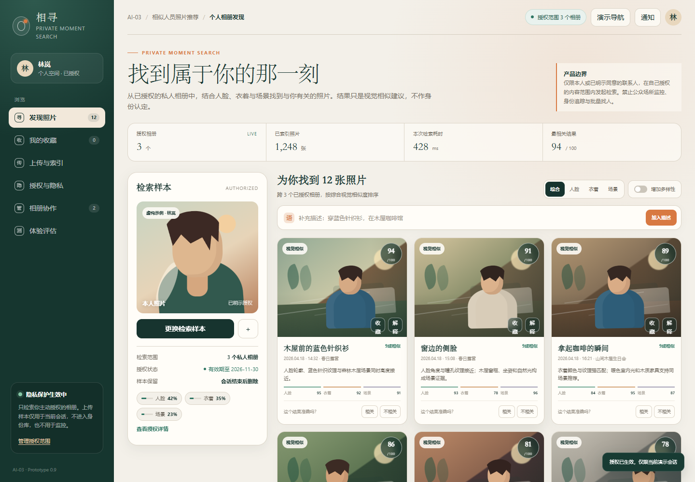

# SE2026-AI-03：基于多模态大模型的相似人员照片推荐系统

> 项目编号：SE2026-AI-03
>
> 当前阶段：交互原型与系统设计

相寻是一个面向**已授权私人相册**的照片发现系统。用户可以上传一张检索样本并补充衣着、场景等自然语言描述，系统结合人脸、人体、衣着和场景特征返回可能与其本人有关的照片，并展示推荐依据。

项目严格限制使用场景：不提供公共场所找人、陌生人检索、真实身份核验、批量导出或监控能力。



## 当前完成内容

- 明示同意、授权范围、有效期和撤回入口。
- 照片上传、权利确认和模拟特征提取流程。
- 人脸、衣着、场景的多模态检索交互。
- 综合、人脸、衣着、场景排序及多样性重排。
- 单张结果的证据分解和推荐解释。
- 相关/不相关反馈及反馈撤销。
- 相册所有者检索申请审批、7 天临时授权和审计日志。
- 撤回授权、停止检索和索引清理状态。
- 桌面端和移动端响应式布局。
- 系统架构、授权状态机、OpenAPI 接口和 PostgreSQL 数据模型。

## 快速体验

原型是无需安装依赖的离线单页应用。

```bash
git clone https://github.com/hdaskj/renyuanshibiexiotng.git
cd renyuanshibiexiotng
```

直接打开：

```text
frontend/prototype/index.html
```

也可以启动本地静态服务器：

```bash
python -m http.server 8080 --directory frontend/prototype
```

访问 `http://localhost:8080/`。

推荐演示路径：

1. 勾选用途与权利确认，进入个人相册。
2. 打开任一照片的“解释”，查看人脸、衣着、场景证据。
3. 输入“穿蓝色针织衫，在木屋咖啡馆”，观察语义重排。
4. 切换排序并开启“增加多样性”。
5. 对结果选择相关或不相关，观察反馈状态。
6. 进入“相册协作”，审批检索申请并查看审计日志。
7. 进入“授权与隐私”，演示撤回授权和索引清理。

## 工程文档

- [文档索引](docs/README.md)
- [需求分析与教师确认](docs/AI-03-分析设计与教师确认.md)
- [系统设计与接口](docs/AI-03-系统设计与接口.md)
- [OpenAPI 接口契约](docs/api/openapi.yaml)
- [PostgreSQL 数据模型](docs/db/schema.sql)
- [教师评审确认单](docs/AI-03-教师评审确认单.pdf)

## 目录结构

```text
.
├── frontend/
│   └── prototype/              # 当前可运行的交互原型
├── docs/
│   ├── api/                    # OpenAPI 接口契约
│   ├── db/                     # PostgreSQL 数据模型
│   ├── AI-03-分析设计与教师确认.md
│   ├── AI-03-系统设计与接口.md
│   └── AI-03-教师评审确认单.pdf
├── .gitignore
└── README.md
```

规划中的 `backend/`、`model_service/`、`vector_store/` 和 `scripts/` 将在老师确认需求边界后逐步加入。

## 技术路线

| 模块 | 计划技术 |
| --- | --- |
| 前端 | React |
| 后端 | Spring Boot |
| 特征提取 | InsightFace、CLIP、LLaVA |
| 向量检索 | Milvus 或 Faiss |
| 元数据 | PostgreSQL |
| 模型编排 | LangChain |
| 监控与实验 | Prometheus、Grafana、A/B 分流 |

## 验收口径

- Top-K 召回率与 NDCG 的 K 值、标注集和计算规则待老师确认。
- 推荐响应时间的课程目标为服务端 P95 小于 500ms，不含上传和前端渲染。
- 撤回授权后，新检索必须立即被阻断，派生向量进入清理流程。
- 推荐结果只能表述为“视觉相似建议”，不能作为真实身份认定。

## 数据与伦理

- 仅处理用户拥有合法使用权的私人相册内容。
- 检索前需要相册所有者批准，并记录用途、范围和有效期。
- 检索样本仅在当前任务中使用，不建立可搜索的公开身份库。
- 用户可关闭单个相册授权或撤回全部授权。
- 系统不提供公众场所监控、批量找人、身份核验和公开分享能力。

## 当前限制

当前仓库中的原型用于验证交互和业务闭环。CLIP/InsightFace 推理、Milvus/Faiss、Spring Boot 后端、React 工程化版本、灰度发布和生产级监控尚未接入；原型中的分值和响应时间均为演示数据，不代表真实模型结果。
