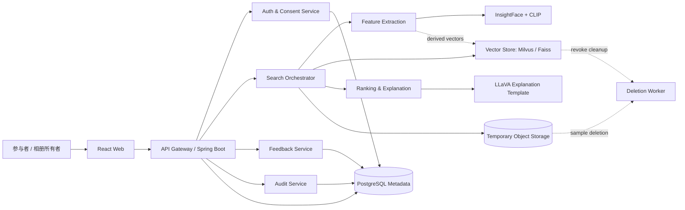
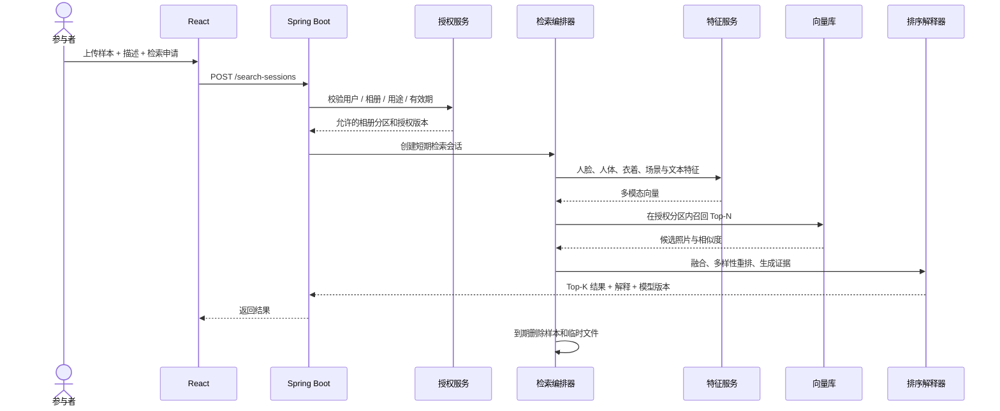
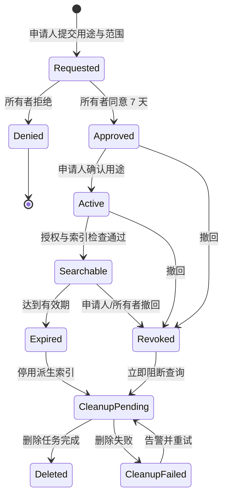
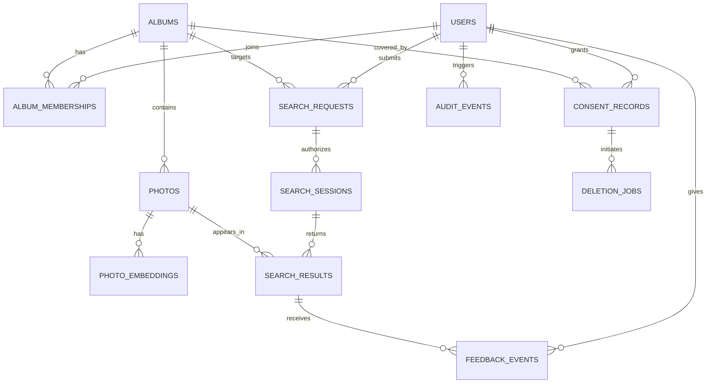

# AI-03 相寻系统设计与接口

## 1. 设计目标

系统在“授权私人相册”内完成多模态照片检索，解决三个问题：

1. 如何用一张照片和一句场景描述找回与本人有关的照片。
2. 如何让推荐结果可解释、可纠错，并避免“视觉相似”被误读成身份认定。
3. 如何让相册所有者、被摄者和检索申请人共同控制数据范围，并支持撤回和审计。

当前仓库已进一步实现可运行的 V0.1 MVP：Spring Boot 后端、Python 特征服务桩、H2 元数据、本地向量索引适配器和真实 API 联调页面。CLIP/InsightFace/LLaVA 真实推理、Milvus/Faiss 和 PostgreSQL 仍属于下一阶段替换项。

## 2. 参与者与权限

| 参与者 | 主要权限 | 明确限制 |
| --- | --- | --- |
| 参与者 | 申请检索、上传临时样本、查看本人相关结果、反馈、撤回授权 | 不能浏览完整相册，不能查询陌生人、身份、行踪或批量导出 |
| 相册所有者 | 管理相册参与者、审批检索请求、设置有效期、查看审计、关闭授权 | 不能代替未同意者做超出原授权用途的决定 |
| 管理员 | 索引任务、模型版本、灰度、监控、删除任务 | 默认不可查看原图；敏感操作必须双人审批并留痕 |
| 推荐服务 | 提取特征、召回、融合排序、生成有证据约束的解释 | 不返回真实身份、联系方式或推断结果 |

## 3. 关键业务规则

- `BR-01` 每次检索必须有有效的相册授权、检索申请授权和用途声明。
- `BR-02` 检索请求只允许指定“本人照片”，不能用于查找陌生人。
- `BR-03` 原始照片和检索样本不进入公开索引；检索样本在任务结束后删除。
- `BR-04` 结果以视觉相似分、匹配证据和授权来源呈现，不能表述为身份确认。
- `BR-05` 任一必要授权被撤回后，查询链路立即阻断，删除任务异步清理派生向量。
- `BR-06` 所有申请、审批、查询、反馈、撤回和删除操作写入审计日志。
- `BR-07` 推荐排序加入多样性重排，避免单相册或单场景占满结果。
- `BR-08` 实验分组不能绕过上述规则；实验配置需版本化并记录到结果元数据。

## 4. 系统架构



### 4.1 分层职责

- 体验层：展示检索样本、排序控制、推荐解释、授权状态与错误恢复。
- 授权层：先验证用户、相册成员、授权记录、有效期和用途，再允许检索。
- 检索层：提取多模态特征，按租户/相册分区召回，完成融合排序与多样性重排。
- 解释层：只消费结构化证据，生成可追溯的解释，不允许自由编造身份事实。
- 数据层：PostgreSQL 保存业务元数据和审计事件，向量库保存派生特征，对象存储仅保存短期任务文件。
- 运维层：Prometheus + Grafana 监控延迟、召回、错误率、删除积压和授权异常。

## 5. 核心检索时序



## 6. 授权状态机



`CleanupPending` 和 `CleanupFailed` 必须对用户可见；系统不能把“已撤回”渲染成“已删除”，必须有独立完成状态。

## 7. 数据模型



完整 PostgreSQL DDL 见 `db/schema.sql`。

## 8. 推荐与解释设计

### 8.1 召回

- 人脸/人体向量：InsightFace。
- 衣着与场景向量：CLIP 图像编码器。
- 文字描述向量：CLIP 文本编码器；将“蓝色针织衫、木屋咖啡馆”等描述映射到同一语义空间。
- 向量库按租户、相册、授权版本分区，不使用全局身份索引。

### 8.2 融合排序

原型使用可解释的初始权重：

```text
overall = 0.42 * face + 0.35 * outfit + 0.23 * scene + context_bonus - feedback_penalty
```

最终权重需通过验证集和 A/B 测试确定。排序输出必须保留各分项分值、模型版本和实验组，便于审计与复现。

### 8.3 多样性

对候选结果执行 MMR 或分组配额：

- 同一相册在前 10 条中最多占 70%。
- 同一场景在前 10 条中最多占 60%。
- 低分但来自不同相册/场景的结果可进入补充位。

### 8.4 解释生成

解释输入只包含结构化事实，例如：

```json
{
  "scores": {"face": 0.95, "outfit": 0.92, "scene": 0.91},
  "facts": ["蓝色针织衫", "木屋", "侧身", "同次活动"],
  "disclaimer": "视觉相似建议，不是身份认定"
}
```

LLaVA 只负责组织语言。若模型生成了“这是某人”或超出证据的推断，解释服务必须拒绝并回退到模板。

## 9. API 契约

完整 OpenAPI 见 `api/openapi.yaml`。

| 方法 | 路径 | 目的 |
| --- | --- | --- |
| `GET` | `/v1/albums` | 返回当前用户可管理的相册 |
| `POST` | `/v1/search-requests` | 参与者提交本人照片检索申请 |
| `PATCH` | `/v1/search-requests/{requestId}` | 相册所有者同意或拒绝 |
| `POST` | `/v1/search-sessions` | 上传临时样本并发起检索 |
| `GET` | `/v1/search-sessions/{sessionId}/results` | 获取 Top-K 结果与解释 |
| `POST` | `/v1/feedback` | 记录相关/不相关反馈 |
| `DELETE` | `/v1/consents/{consentId}` | 撤回授权并创建清理任务 |
| `GET` | `/v1/audit-events` | 所有者查看授权与检索审计 |
| `GET` | `/v1/experiments/summary` | 查看灰度策略和指标摘要 |

所有接口返回 `requestId`，敏感操作还返回 `auditEventId` 和 `policyVersion`。

## 10. 非功能与验收指标

| 维度 | 目标 |
| --- | --- |
| 检索响应 | 服务端 P95 小于 500ms，不含图片上传与前端渲染 |
| 首屏可用 | 支持 9 条结果和分页加载，移动端最低 320px |
| 授权阻断 | 撤回后下一次查询在 100ms 内被拒绝，且无法从缓存读出旧结果 |
| 删除时效 | 派生向量与临时样本在 24 小时内完成删除，状态可查询 |
| 可解释性 | 每条结果至少包含人脸、衣着、场景三项证据和身份限制声明 |
| 可追溯性 | 授权、检索、反馈、撤回、模型版本和实验分组均可审计 |
| 可用性 | 异常态不丢失用户操作；失败时提供重试与清理路径 |
| 安全保障 | 租户隔离、最小权限、字段加密、对象存储短签名 URL、速率限制 |

## 11. 测试用例

| 编号 | 场景 | 预期结果 |
| --- | --- | --- |
| `T-01` | 未勾选用途与权利确认 | 不能进入检索，主按钮保持禁用 |
| `T-02` | 相册授权已过期 | 查询被拒绝，不返回缓存结果，显示重新申请入口 |
| `T-03` | 上传非图片文件 | 本地校验失败，不创建检索会话 |
| `T-04` | 自然语言补充“蓝色针织衫” | 蓝色衣着候选排名上升，并记录查询语义向量 |
| `T-05` | 切换场景排序 | 场景分成为主排序依据，结果立即重排 |
| `T-06` | 打开任意结果解释 | 显示三类证据、模型版本和非身份认定声明 |
| `T-07` | 对结果标记不相关 | 反馈持久化，同类结果权重下降，且可撤销 |
| `T-08` | 相册所有者同意申请 | 授权有效 7 天，审计日志写入审批事件 |
| `T-09` | 相册所有者拒绝申请 | 申请人无法发起查询，且不暴露相册内容 |
| `T-10` | 参与者撤回授权 | 立即停止新查询，创建清理任务，原始照片不受影响 |
| `T-11` | 清理任务失败 | 用户看到“清理失败/重试中”，管理员告警，不得显示为已删除 |
| `T-12` | 同一相册占满 Top-K | 多样性重排后为其他相册和场景保留名额 |
| `T-13` | 利用已缓存结果绕过撤回 | 结果缓存按授权版本失效，撤回后缓存命中失败 |
| `T-14` | 解释模型输出身份判断 | 解释被拦截并回退到证据模板 |

## 12. 实施顺序

1. 完成老师确认与产品边界冻结。
2. 实现 React 页面、授权中心、审批台和异常态。
3. 建立 Spring Boot API、PostgreSQL 表与审计日志。
4. 接入特征服务与 Milvus，先完成单相册闭环。
5. 增加反馈排序、多样性重排、实验分流和监控。
6. 建立合规测试、删除任务演练、压测和演示数据。

## 13. 尚待老师确认

详见 `AI-03-分析设计与教师确认.md` 第 8 节。优先确认产品边界、K 值/NDCG 口径、500ms 的定义以及授权有效期策略，再冻结接口和验收测试。
